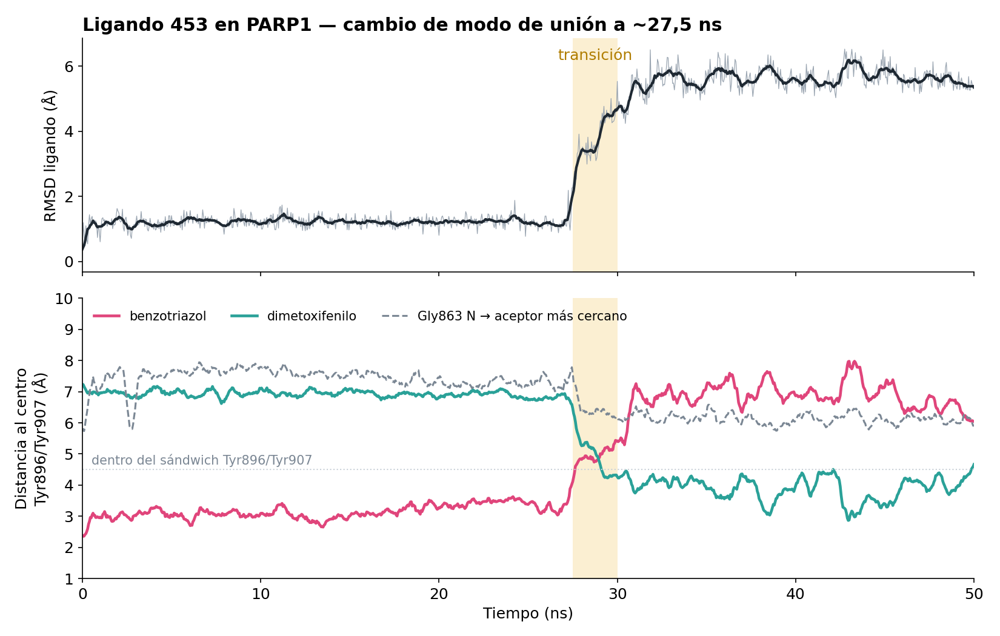
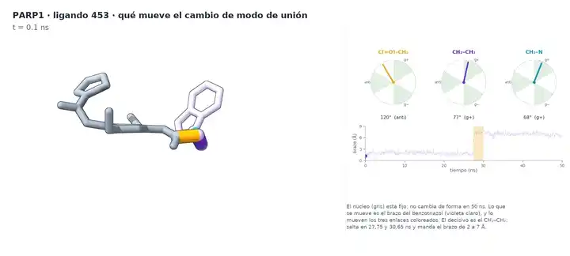
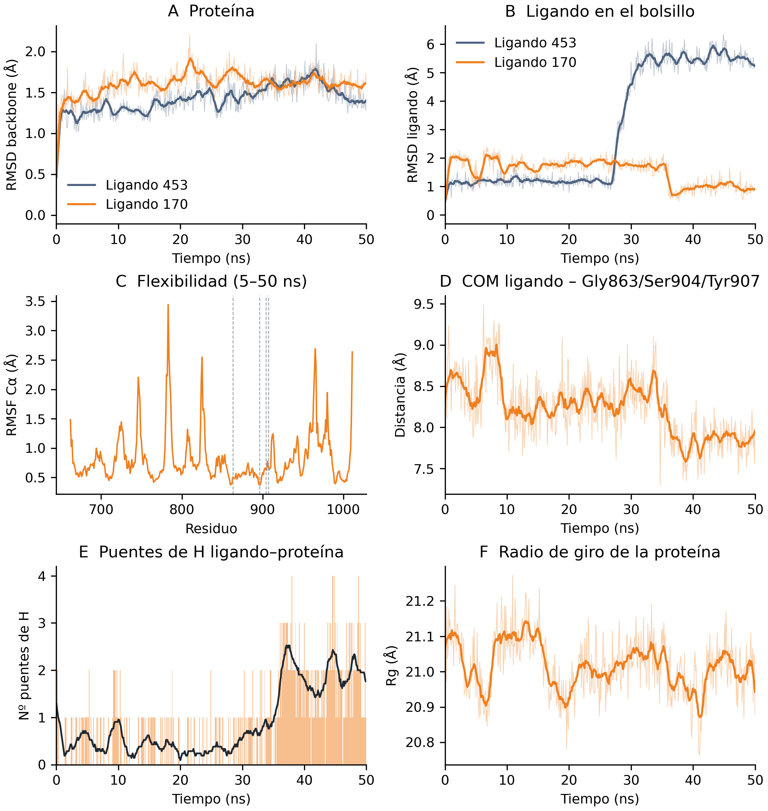

# PARP1 — Virtual screening and exploratory molecular dynamics

A reproducible, mostly open-source pipeline that prioritises candidate
PARP1 inhibitors from structural, pharmacophoric and docking evidence,
followed by an exploratory molecular dynamics check on the top-ranked
candidate.

**Two phases, two different levels of maturity:**

| | Phase 1 — Virtual screening | Phase 2 — Molecular dynamics |
|---|---|---|
| What | Pharmacophore-based screening and docking | One 50 ns MD replica of ligand 453 |
| Context | **MSc thesis** (Trabajo Fin de Máster) | **Additional self-directed work**, ~2 months later |
| Purpose | Build and evaluate a reproducible workflow | Learning exercise; exploratory |
| Status | Complete | Exploratory, single replica, not a validation study |

> Phase 2 is **not** part of the thesis and was not designed as a
> validation study. Read [docs/limitations.md](docs/limitations.md)
> before drawing anything from it.

*Resumen en español: [docs/README.es.md](docs/README.es.md)*

---

## The thread

```
34 PARP1 structures (RCSB + AlphaFold)
          │  PLIP interaction analysis of the catalytic pocket
          ▼
   consensus pharmacophore
          │  retrospective refinement against knowns + decoys
          ▼
   Pharmit screening  →  1,479,579 molecules  →  top 1,000 by RMSD fit
          │  RDKit fingerprints + Butina clustering
          ▼
   855 structural representatives
          │  GNINA docking (CNN rescoring)
          ▼
   31 prioritised candidates   (Vina ≤ −10 kcal/mol and CNNscore ≥ 0.5)
          │  highest CNNscore of the 31
          ▼
   ligand 453  →  50 ns MD  →  docking pose lost at ~28 ns
```

The last step is the point of the whole repository: a candidate that
ranks first on one docking metric does not necessarily hold its
predicted pose.

## Phase 1 — Virtual screening (MSc thesis)

PARP1 is a nuclear enzyme involved in DNA damage detection and
signalling. Its catalytic domain is the target of clinical PARP
inhibitors such as olaparib, niraparib and veliparib, which compete with
the NAD⁺ cofactor at the catalytic site.

The goal was **not** to discover a drug, but to build and evaluate a
reproducible computational workflow that prioritises candidates by
combining structural, pharmacophoric and docking evidence.

Full write-up: [docs/01_virtual_screening.md](docs/01_virtual_screening.md)

Key parameters: GNINA 1.3.3, box centred at (8.59, 39.35, 9.53) with
size 22 × 16 × 24 Å, `--exhaustiveness 8`, `--num_modes 10`,
`--seed 1`. Candidates were prioritised by requiring **both**
Vina_score ≤ −10 kcal/mol **and** CNNscore ≥ 0.5, which leaves 31 of the
855 docked representatives.

## Phase 2 — Exploratory molecular dynamics (additional work)

A single 50 ns MD replica of ligand 453 (MolPort-000-056-093) was run as
a self-directed learning exercise about two months after the thesis was
completed. It is exploratory and was not designed as a validation study.

Ligand 453 was picked because it has the **highest CNNscore of the 31**
candidates (0.8281) and is effectively tied for the highest CNNaffinity
(7.360 vs 7.365 for the next one). It is worth being precise here: by
Vina score alone it ranks **16th of the 31** (−10.61 kcal/mol, against
−12.06 for the best). So it was the best candidate on GNINA's neural
scoring, not on the classical energy estimate.

**The docking pose was retained for approximately 28 ns** (ligand
heavy-atom RMSD ≈ 1.2 Å) **and then shifted to a different binding
mode** (RMSD ≈ 5.6 Å over the remaining 20 ns). The benzotriazole, which
initially sits between Tyr896 and Tyr907, gives up that position to the
dimethoxyphenyl group. The hydrogen bond to Ala880 is lost and new ones
to Tyr896 and Asp766 appear. No hydrogen bond to Gly863 or Ser904 — the
canonical PARP1 inhibitor contacts — is observed at any point.

**This indicates that a favourable docking score does not guarantee pose
stability. It does *not* indicate that the ligand is inactive.** One
50 ns replica cannot support that claim.

**What drives the change:** a rotamer change in the propanamide linker
of the benzotriazole. The CH₂–CH₂ torsion goes *gauche*+ → *gauche*− at
**27.75 ns** and → *anti* at **30.65 ns**; the rings rearrange after it,
not before. Of the ligand's **ten rotatable bonds it is the only one
that changes rotamer inside the transition window**; the rest either
never do, or do so from 31.25 ns onwards, once the rearrangement is
over. Neither amide bond moves at all over the 50 ns. With n = 1
the honest statement is that the torsion *precedes* the rearrangement,
not that it causes it.

**An important caveat, found the same way:** the thiophene amide entered
the simulation **32.2° out of plane**, a geometry that is not a minimum
of anything, inherited from the Pharmit conformer. Minimisation dropped
it into the planar ***cis*** well, where a 17.6 kcal/mol barrier kept it
for all 50 ns — against an equilibrium *cis* population of 0.41 % that
the force field itself predicts. The measurement is sound; the conformer
it was made on probably is not. See
[docs/limitations.md](docs/limitations.md).



[](https://github.com/AndoniM12/PARP1-Virtual-Screening/releases/download/v2.1/ligando453_torsiones.mp4)

*The ligand alone over the full trajectory, superimposed on its **core** so that the core stays fixed and the benzotriazole arm is seen to swing. Three live dials, one per linker bond; below them, how far the arm has travelled. The CH₂–CH₂ needle jumps at 27.75 and 30.65 ns and sends the arm from 2 to 7 Å. Preview above is reduced (720 px, 7 fps); click for the [full 60 fps video](https://github.com/AndoniM12/PARP1-Virtual-Screening/releases/download/v2.1/ligando453_torsiones.mp4) (2000×900, 33 s, 10 MB).*

Two further videos — the 50 ns animation in the binding site and the amide
analysis — are in the same release. All of them, and the light trajectory, are
release assets rather than repository files, so cloning stays cheap:
**[Release v2.1](https://github.com/AndoniM12/PARP1-Virtual-Screening/releases/tag/v2.1)**.

Full parameters: [docs/02_molecular_dynamics.md](docs/02_molecular_dynamics.md)
· Results: [results/md/ligand_453/README.md](results/md/ligand_453/README.md)

#### A second ligand, for contrast

Ligand **170** (Molport-053-317-044) was run afterwards under the same
protocol, and it behaves the opposite way: the docked pose holds for all
50 ns (ligand RMSD below 2.4 Å), and at ~36 ns it settles *closer* to the
starting pose, forming the hydrogen bonds a PARP1 inhibitor is expected to
make in the nicotinamide pocket — **Ser904** (48 % of the last 14 ns) and
**Gly863** (18 %), neither of which ligand 453 ever formed.



One replica each, so this is one trajectory against another trajectory,
not a measurement. Results: [results/md/ligand_170/README.md](results/md/ligand_170/README.md)
· Both side by side: [results/md/README.md](results/md/README.md)

### Limitations

Single replica · 50 ns · 200 ps of equilibration · no position
restraints during equilibration · neutralised with a single counter-ion
and no added salt · force-field and ligand-parametrisation effects not
examined · the input conformer had one amide 32° out of plane, which the
simulation inherited.

Details: [docs/limitations.md](docs/limitations.md)

## Tools and versions

| Tool | Version | Used for |
|---|---|---|
| Python | 3.12 (screening) / 3.11 (MD) / 3.13 (OpenFF) | pipeline scripts |
| RDKit | 2025.03.6 | fingerprints, clustering, molecule handling |
| PLIP | 3.0.0 | protein-ligand interaction detection |
| PyMOL | 3.1.0 | structure superposition and visualisation |
| Pharmit | web interface (version not recorded) | pharmacophore screening |
| GNINA | 1.3.3 | docking and CNN rescoring |
| GROMACS | 2026.3 | molecular dynamics |
| OpenFF Toolkit | 0.19.0 | ligand parametrisation (`openff-2.2.1.offxml`) |
| OpenFF NAGL | 0.5.5 | partial charges (`openff-gnn-am1bcc-1.0.0`) |
| PDBFixer | 1.12 | structure repair |
| UCSF ChimeraX | 1.12 | trajectory analysis and rendering |

Force fields: **amber19sb** (protein), **OpenFF 2.2.1** (ligand),
**TIP3P** (water).

## Repository layout

```
docs/          write-ups: screening, MD, limitations, provenance
environment/   one Conda file per environment used
data/
  raw/         input structures (7AAA, 9ETQ, PDB table)
  structures/  downloaded and processed PDBs, git-ignored (script 01-03)
  md/          MD topology, ligand 453 parameters, frame 0
scripts/
  screening/   phase 1 pipeline (01–11) + pharmacophore refinement
  md/          phase 2 preparation and run scripts
  md_analysis/ ChimeraX analysis and rendering
results/
  docking/     GNINA scores, 31 candidates, interactions
  pharmacophore/ consensus table and PyMOL/JSON models
  pharmit/     refined models: the three Pharmit sessions + union table
  md/          RMSD tables, figures, video, GROMACS logs
run/           working directory, git-ignored
```

## Reproducing it

### Phase 1

```bash
conda env create -f environment/screening.yml
conda activate parp1_pipeline   # required: step 03 calls the `plip` binary

python scripts/screening/01_descargar_pdbs.py   # download + collect structures
python scripts/screening/02_procesar_pdb.py     # clean and superpose
python scripts/screening/03_contactos.py        # PLIP contacts
python scripts/screening/04_lectura.py
python scripts/screening/05_farmacoforo_data.py
python scripts/screening/06_gen_farmacoforo.py  # consensus pharmacophore
python scripts/screening/08_validation_set.py
python scripts/screening/09_refinamiento_farmacoforo.py   # refine + export Pharmit sessions
python scripts/screening/10_clustering_repr.py  # Butina clustering
python scripts/screening/11_docking.py          # GNINA (install separately)
```

**Structures.** Step 01 downloads 30 entries from the RCSB plus the AlphaFold
model, and copies in the ones the RCSB does not serve in PDB format. That is the
case of **9ETQ** (saruparib / AZD5305), for which `files.rcsb.org` returns 404:
it ships with the repository in `data/raw/9ETQ.pdb` and step 01 copies it into
place. It belongs to the **Training set**, so it feeds the consensus
pharmacophore — without it the consensus is built on five structures instead of
six and every later result changes.

**Reproducibility caveat.** PLIP's hydrogen-bond detection is not deterministic:
on a byte-identical input, one borderline contact with Arg878 in 9ETQ is found in
roughly four runs out of ten. That feature is Optional, so it appears only in the
`all` model — which has **0 % retrospective recovery** and was not used for
screening. The two models that were used, `core` (100 % recovery) and
`recommended` (82.6 %), reproduce **identically**, and so do the 855 docking
inputs. See [docs/provenance.md](docs/provenance.md).

`09_refinamiento_farmacoforo.py` refines each model separately and writes both the
three Pharmit session files (`results/pharmit/farmacoforo_{core,recommended,all}.json`,
the output that is actually used) and a union table for inspection. The
screen itself runs in the Pharmit web interface and its output is fed
back in.

The union table must **not** be filtered by `Classification` to rebuild a
model: refinement is model-dependent, so the union has 13 features while
the `all` model has 12. Exporting from it was a real bug, now fixed —
see [docs/provenance.md](docs/provenance.md).

### Phase 2

```bash
conda env create -f environment/md_gromacs.yml
conda env create -f environment/ligand_openff.yml

bash scripts/md/run_md.sh prep      # preparation (uses both environments)
bash scripts/md/run_md.sh equil     # minimisation, NVT, NPT
bash scripts/md/run_md.sh prod      # 50 ns production (~5 days on 4 CPU threads)
bash scripts/md/run_md.sh analysis  # centre the trajectory
```

Analysis and figure, with `traj_ligera.xtc` placed in `data/md/ligand_453/`:

```bash
# in ChimeraX, started from the repository root
open data/md/ligand_453/frame0.pdb
open data/md/ligand_453/traj_ligera.xtc structureModel #1
runscript scripts/md_analysis/analiza.py
runscript scripts/md_analysis/anillos.py
```

**Note on exact reproducibility:** the production run used a random seed
(`gen-seed = -1`). The effective seeds are recorded in the GROMACS logs
and listed in [docs/provenance.md](docs/provenance.md); pin them in the
`.mdp` files to reproduce the original trajectory.

## Large files

Not in the repository, by size:

| File | Size | Where |
|---|---|---|
| `ligando453_animacion_60fps.mp4`, `ligando453_amidas.mp4`, `ligando453_torsiones.mp4` | 31 MB, 12 MB, 10 MB | **[release v2.1](https://github.com/AndoniM12/PARP1-Virtual-Screening/releases/tag/v2.1)** — only the reduced previews live in the repository |
| `traj_ligera.xtc` | 21 MB | **[release v2.1](https://github.com/AndoniM12/PARP1-Virtual-Screening/releases/tag/v2.1)** — needed to regenerate MD tables and figures |
| Full 50 ns trajectories | 1.8 GB | not distributed; regenerable |
| `pharmit.sdf` (1,479,579 molecules) | 2.8 GB | not distributed; kept locally |

## Current status

- **Phase 1** — complete. Pipeline runs end to end; 31 candidates
  prioritised.
- **Phase 2** — exploratory, complete as far as it goes. One replica.
  The amide torsion check is **done**: neither amide rotates, and the
  transition is a linker rotamer change. The remaining open questions
  are listed in [docs/limitations.md](docs/limitations.md); re-running
  the simulation from a *trans* conformer is the substantive one.
- **Release with the light trajectory and the other two videos** — not
  yet published. The 60 fps video is already in the repository.
- A separate, ongoing repository extends this work to a systematic
  second-level validation of all 31 candidates (decoys, ensemble
  docking, MD, MM/GBSA, selectivity, ADMET). It is not part of this
  repository.

## Provenance

Some steps originally existed only in shell history and have been turned
into scripts; some details could not be recovered at all. Both are
documented honestly in [docs/provenance.md](docs/provenance.md), which
also lists every path that was rewritten during the reorganisation.

## Author

Andoni Moreno — MSc in Bioinformatics
