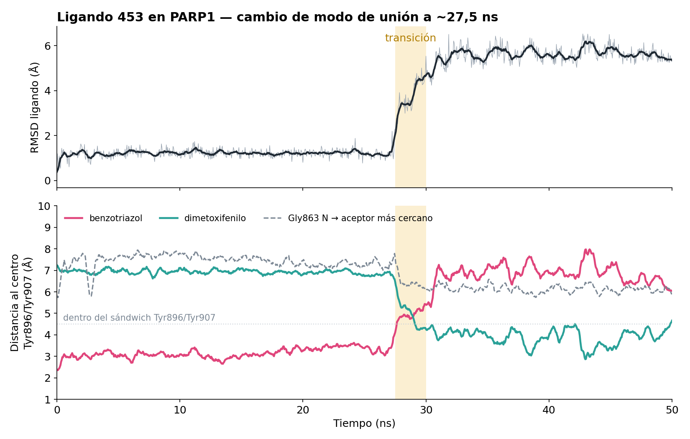

# Fase 2 — Dinámica molecular del ligando 453

> **Trabajo adicional, posterior al TFM.** Una sola réplica de 50 ns,
> hecha unos dos meses después de terminar el TFM como ejercicio para
> aprender. No forma parte del Trabajo Fin de Máster ni se diseñó como
> un estudio de validación.

El ligando 453 (MolPort-000-056-093) se eligió por ser el candidato con
el **CNNscore más alto de los 31** (0,8281) y estar prácticamente
empatado en CNNaffinity (7,360 frente a 7,365 del siguiente).

Conviene ser preciso: por Vina score es el **16.º de los 31**
(−10,61 kcal/mol, frente a −12,06 del mejor). Es decir, era el mejor
candidato según la puntuación neuronal de GNINA, no según la estimación
energética clásica.

Esta simulación comprueba si la pose que predijo el docking se mantiene
en un entorno explícito de disolvente.

## Parámetros

Todos los valores de esta tabla están tomados de ficheros del
repositorio. Lo que no se ha podido recuperar está en
[provenance.md](provenance.md) y aquí aparece como «no recuperado».

### Sistema

| Parámetro | Valor | De dónde sale |
|---|---|---|
| Estructura de partida | PDB **7AAA**, cadena A | `data/raw/7AAA.pdb` |
| Preparación | PDBFixer: solo cadena A; átomos pesados ausentes reconstruidos; residuos ausentes **no** reconstruidos (Gly660 y Ser661 quedan fuera a propósito, por estar fuera de la región estructural experimental) | `scripts/md/reparar_proteina.py` |
| Hidrógenos | añadidos por `gmx pdb2gmx` | `data/md/topology/topol.top` |
| Campo de fuerza de la proteína | **amber19sb** | línea de `pdb2gmx` registrada en `topol.top` |
| Modelo de agua | **TIP3P** (caja de partida `spc216.gro`) | `topol.top` + historial |
| Caja | **dodecaedro**, 1,0 nm de margen al soluto | `gmx editconf -bt dodecahedron -d 1.0` |
| Disolvente | **15 201** moléculas de agua | `[ molecules ]` de `topol.top` |
| Contraiones | **1 Cl⁻**, solo para neutralizar. **Sin sal añadida** | `[ molecules ]` de `topol.top` |
| Átomos totales | 5 546 (proteína) + 53 (ligando) + disolvente | `scripts/md/montar_complejo.py` |

### Ligando

| Parámetro | Valor | De dónde sale |
|---|---|---|
| Identificadores | MolPort-000-056-093 · CHEMBL1507270 · PubChem 655444 · ZINC000001324433 | `data/md/ligand_453/ligando_453.sdf` |
| SMILES | `COc1cc(NC(=O)c2cccs2)c(OC)cc1NC(=O)CCn1nnc2ccccc21` | del SDF, con RDKit |
| Grupos | dimetoxifenilo · tiofeno · benzotriazol · **dos amidas** | ídem |
| Átomos | 32 pesados, 53 con hidrógenos | ídem |
| Campo de fuerza | **OpenFF 2.2.1** (`openff-2.2.1.offxml`) | `scripts/md/parametrizacion.py` |
| Cargas parciales | **NAGL**, modelo `openff-gnn-am1bcc-1.0.0` | ídem |
| Exportación a GROMACS | `openff.interchange`, topología modular (`monolithic=False`) | ídem |
| Pose inicial | la del docking con GNINA, trasladada átomo a átomo del MOL2 mediante correspondencia por subestructura máxima (MCS); los hidrógenos se recolocan con la misma rotación y longitudes de enlace estándar | `scripts/md/{construir,generar}_ligando_docked*.py` |

### Protocolo

| Etapa | Parámetros | Fichero |
|---|---|---|
| Minimización | `steep`, `emtol` 1000 kJ/mol/nm, máx. 50 000 pasos. Convergió en **1099 pasos** (Epot −7,72·10⁵ kJ/mol, Fmax 958) | `scripts/md/mdp/em.mdp`, `results/md/logs/` |
| Equilibrado NVT | **100 ps** (50 000 × 2 fs), V-rescale, 300 K, τ_t 0,1 ps, velocidades generadas | `mdp/nvt.mdp` |
| Equilibrado NPT | **100 ps**, C-rescale, 1 bar, τ_p 2,0 ps, isotrópico | `mdp/npt.mdp` |
| Producción | **50 ns** (25 000 000 × 2 fs), NPT, fotograma cada 10 ps | `mdp/md_50ns.mdp` |
| Integración | `dt` **2 fs**, restricciones `h-bonds` con LINCS | todos los `.mdp` |
| Electrostática | **PME**, `rcoulomb` 1,0 nm | ídem |
| Van der Waals | corte simple, `rvdw` 1,0 nm, **sin corrección de dispersión** (`DispCorr = No`) | ídem + `md_50ns.log` |
| Lista de vecinos | Verlet, `nstlist` 20, `rlist` 1,025 nm (ajustado por GROMACS) | `md_50ns.log` |
| Restricciones de posición | **ninguna**: ningún `.mdp` define `-DPOSRES` | los `.mdp` |

### Ejecución

| | |
|---|---|
| GROMACS | **2026.3-conda_forge** |
| Hardware | solo CPU (`-nb cpu`), 1 rango MPI, **4 hilos OpenMP** |
| Rendimiento | ~10 ns/día |
| Fechas | 3 a 8 de septiembre de 2026, ~5 días |
| Finalización | alcanzó el paso 25 000 000 / 50 000,00 ps |
| Reanudaciones | la ejecución se paró y reanudó varias veces desde el checkpoint (monitor térmico); los logs previos están como `#md_50ns.log.N#` en la carpeta original |

## Cómo se calculó el RMSD

Esto importa para leer la gráfica, así que conviene ser explícito:

- **Lo que se alinea:** el *backbone* de la proteína. El ajuste ya está
  hecho en `traj_ligera.xtc`, antes del análisis.
- **Lo que se mide:** los **32 átomos pesados del ligando**, comparados
  contra el **fotograma 0**, sin volver a superponer el ligando.

Es decir: cuánto se ha desplazado el ligando respecto a su pose inicial,
una vez quitado el movimiento global de la proteína. No es un RMSD
interno del ligando ni un RMSD de la proteína.

El código está en `scripts/md_analysis/analiza.py`, que además cuenta
los puentes de hidrógeno (`find_hbonds` de ChimeraX, sin criterios
relajados) y los contactos (átomo pesado a menos de 4 Å) fotograma a
fotograma.

**Advertencia:** el comando exacto de `gmx trjconv` que generó
`traj_ligera.xtc` **no se ha recuperado**. Se sabe por el README original
que la trayectoria no tiene agua, está ajustada al backbone y guarda un
fotograma cada 50 ps (1001 en total), pero no con qué grupo ni con qué
opción de `-fit`. Ver [provenance.md](provenance.md).

## Resultados

Las cifras salen de `results/md/tables/por_fotograma.csv`, recalculadas
para comprobarlas:

| Ventana | RMSD del ligando | Puentes de H |
|---|---|---|
| 0 – 27,5 ns | media **1,21 Å** (máx. 2,26) | Ala880 34 % |
| 27,5 – 30 ns | transición | Asp766 20 %, Tyr896 12 % |
| 30 – 50 ns | media **5,60 Å** (4,24 – 6,53) | **Tyr896 50,9 %, Asp766 50,1 %** |



Lectura de la gráfica:

- Durante unos 28 ns el ligando mantiene la pose del docking, con el
  benzotriazol encajado entre Tyr896 y Tyr907.
- Entre 27,5 y 30 ns pasa a otro modo de unión, y a partir de ahí es el
  dimetoxifenilo el que ocupa el hueco entre las dos tirosinas.
- El puente de hidrógeno con Ala880, presente en la pose inicial, se
  pierde; aparecen los de Tyr896 y Asp766.
- En ningún momento hay puente de hidrógeno con **Gly863** (el aceptor
  más cercano se queda a 6–7 Å) ni con Ser904, que son los contactos
  canónicos de los inhibidores de PARP1.

**Qué significa esto:** que una puntuación favorable de docking no
garantiza que la pose sea estable. **No** significa que el ligando sea
inactivo: una sola réplica de 50 ns no permite afirmar eso.

Las limitaciones están en [limitations.md](limitations.md), y conviene
leerlas antes que los resultados.

## Cómo reproducirlo

Ver el README principal. En resumen, desde la raíz del repositorio:

```bash
conda env create -f environment/md_gromacs.yml
conda env create -f environment/ligand_openff.yml

bash scripts/md/run_md.sh prep      # preparación (dos entornos)
bash scripts/md/run_md.sh equil     # minimización y equilibrado
bash scripts/md/run_md.sh prod      # producción de 50 ns (~5 días en 4 hilos)
bash scripts/md/run_md.sh analysis  # centrado de la trayectoria
```

El análisis y la figura, con `traj_ligera.xtc` colocada en `data/md/`:

```bash
# en ChimeraX, arrancado desde la raíz del repositorio
open data/md/frame0.pdb
open data/md/traj_ligera.xtc structureModel #1
runscript scripts/md_analysis/analiza.py
runscript scripts/md_analysis/anillos.py
```
