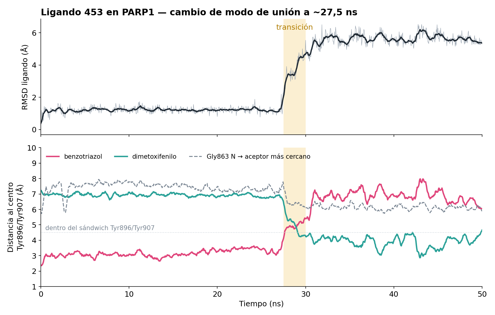
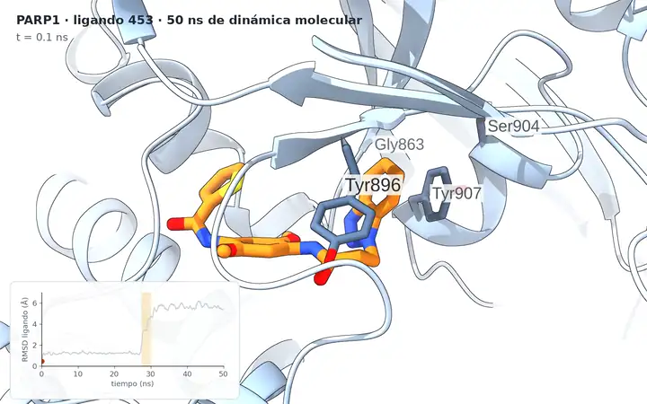
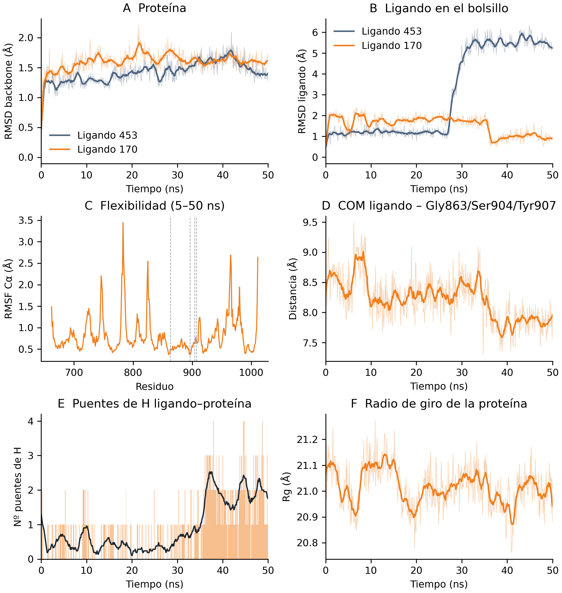

# PARP1 — Cribado virtual y dinámica molecular exploratoria

*Resumen en español. La documentación principal está en el
[README](../README.md), en inglés.*

## Qué es esto

Un pipeline reproducible, basado sobre todo en herramientas de código
abierto, que prioriza posibles inhibidores de PARP1 combinando
información estructural, farmacofórica y de docking. Después, una
comprobación exploratoria con dinámica molecular del candidato
seleccionado.

**Dos fases, con distinto nivel de madurez:**

| | Fase 1 — Cribado virtual | Fase 2 — Dinámica molecular |
|---|---|---|
| Qué es | Cribado por farmacóforo y docking | Una réplica de 50 ns del ligando 453 |
| Contexto | **Trabajo Fin de Máster** | **Trabajo adicional**, ~2 meses después |
| Para qué | Construir y evaluar un flujo reproducible | Ejercicio de aprendizaje; exploratorio |
| Estado | Completa | Exploratoria, una sola réplica |

> La fase 2 **no** forma parte del TFM y no se diseñó como un estudio de
> validación. Antes de sacar conclusiones, lee
> [limitations.md](limitations.md).

## El hilo

```
34 estructuras de PARP1 (RCSB + AlphaFold)
          │  análisis de interacciones con PLIP
          ▼
   farmacóforo de consenso
          │  refinamiento retrospectivo con conocidos y señuelos
          ▼
   cribado con Pharmit  →  1.479.579 moléculas  →  1.000 mejores por RMSD
          │  fingerprints de Morgan + clustering de Butina
          ▼
   855 representantes estructurales
          │  docking con GNINA (reevaluación con CNN)
          ▼
   31 candidatos priorizados   (Vina ≤ −10 kcal/mol y CNNscore ≥ 0,5)
          │  el de mayor CNNscore de los 31
          ▼
   ligando 453  →  50 ns de dinámica  →  pierde la pose a los ~28 ns
```

El último paso es el sentido de todo el repositorio: un candidato que
sale primero en una métrica de docking no mantiene necesariamente la
pose que se le predijo.

## Fase 1 — Cribado virtual (TFM)

PARP1 es una enzima nuclear implicada en la detección y señalización del
daño en el ADN. Su dominio catalítico es la diana de los inhibidores
clínicos de PARP, que compiten con el cofactor NAD⁺.

El objetivo **no** era descubrir un fármaco, sino construir y evaluar un
flujo de trabajo computacional reproducible capaz de priorizar
candidatos.

Documento completo: [01_virtual_screening.md](01_virtual_screening.md)

## Fase 2 — Dinámica molecular exploratoria (trabajo adicional)

Una sola réplica de 50 ns del ligando 453, hecha como ejercicio de
aprendizaje unos dos meses después de terminar el TFM.

El ligando 453 se eligió por tener el **CNNscore más alto de los 31**
candidatos (0,8281). Conviene ser preciso: por Vina score es el 16.º de
los 31 (−10,61 kcal/mol, frente a −12,06 del mejor). Era el mejor según
la puntuación neuronal de GNINA, no según la energía clásica.

**La pose del docking se mantuvo unos 28 ns** (RMSD de los átomos
pesados del ligando ≈ 1,2 Å) **y después pasó a otro modo de unión**
(RMSD ≈ 5,6 Å durante los 20 ns restantes). El benzotriazol, que al
principio está encajado entre Tyr896 y Tyr907, deja el sitio al
dimetoxifenilo. Se pierde el puente de hidrógeno con Ala880 y aparecen
los de Tyr896 y Asp766. En ningún momento hay puente con Gly863 ni con
Ser904, los contactos canónicos de los inhibidores de PARP1.

**Esto indica que una buena puntuación de docking no garantiza que la
pose sea estable. *No* indica que el ligando sea inactivo**: una sola
réplica de 50 ns no permite afirmar tal cosa.



[](../results/md/ligand_453/videos/ligando453_animacion_60fps.mp4)

*Los 50 ns completos, con cámara lenta ×6 durante el cambio de modo de unión (27,5–30 ns) y el RMSD sincronizado. La animación es una vista previa reducida (720 px, 24 fps); al pulsarla se abre el [vídeo completo a 60 fps](../results/md/ligand_453/videos/ligando453_animacion_60fps.mp4) (1600×1000, 31 MB).*

Parámetros completos: [02_molecular_dynamics.md](02_molecular_dynamics.md)
· Resultados: [../results/md/ligand_453/README.md](../results/md/ligand_453/README.md)

#### Un segundo ligando, para contrastar

El ligando **170** (Molport-053-317-044) se simuló después con el mismo
protocolo, y hace lo contrario: la pose del docking aguanta los 50 ns
(RMSD del ligando por debajo de 2,4 Å) y hacia los 36 ns se reacomoda
*acercándose* a la pose de partida, formando los puentes de hidrógeno
canónicos del bolsillo de la nicotinamida —**Ser904** (48 % de los
últimos 14 ns) y **Gly863** (18 %)—, que el 453 no llegó a formar nunca.



Una réplica de cada uno: es una trayectoria contra otra trayectoria, no
una medida. Resultados: [../results/md/ligand_170/README.md](../results/md/ligand_170/README.md)
· Las dos juntas: [../results/md/README.md](../results/md/README.md)

### Limitaciones

Una sola réplica · 50 ns · 200 ps de equilibrado · sin restricciones de
posición durante el equilibrado · neutralizado con un único contraión y
sin sal añadida · efectos del campo de fuerza y de la parametrización
del ligando sin revisar.

El ligando tiene **dos enlaces amida**; **no se ha comprobado** si
alguno gira durante la transición, y habría que verificarlo antes de
interpretar el cambio como un fenómeno físico.

Detalle: [limitations.md](limitations.md)

## Herramientas

amber19sb (proteína) · OpenFF 2.2.1 (ligando) · TIP3P (agua) ·
GROMACS 2026.3 · GNINA 1.3.3 · RDKit 2025.03.6 · PLIP 3.0.0 ·
PyMOL 3.1.0 · ChimeraX 1.12 · PDBFixer 1.12

## Cómo reproducirlo

Los pasos están en el [README principal](../README.md#reproducing-it).
En resumen: un entorno de Conda por fase
([environment/](../environment/)), los scripts de la fase 1 en
`scripts/screening/` y los de la fase 2 en `scripts/md/`, lanzados desde
la raíz del repositorio.

## Aviso sobre la reproducibilidad

El pipeline se ha reejecutado entero partiendo solo de lo publicado. Reproduce
exacto las 31 estructuras procesadas, los 855 ligandos del docking (mismos
nombres y SMILES) y los modelos `core` y `recommended`.

La única diferencia está en una característica: **PLIP no es determinista** y el
puente de hidrógeno con Arg878 en 9ETQ aparece solo en 4 de cada 10 ejecuciones.

No afecta al cribado. Esa característica es Optional, así que solo entra en el
modelo `all`, que recupera un **0 %** de los activos conocidos y no se usó para
cribar. Los que sí se usaron, `core` (100 % de recuperación) y `recommended`
(82,6 %), reproducen idénticos. Cifras en [provenance.md](provenance.md).

## Procedencia y lagunas

Varios pasos existían solo en el historial de terminal y se han
convertido en scripts. Otros detalles no se han podido recuperar y así
se dice, sin reconstruirlos de memoria. Todo está en
[provenance.md](provenance.md), que además lista cada ruta que se
reescribió al reorganizar.

## Estado actual

- **Fase 1** — completa.
- **Fase 2** — exploratoria. Una sola réplica. Lo primero pendiente es
  comprobar el diedro de las amidas.
- **Release con la trayectoria ligera y los otros dos vídeos** — sin
  publicar todavía. El vídeo de 60 fps ya está en el repositorio.
- Hay un repositorio aparte, en curso, que extiende esto a una
  validación sistemática de los 31 candidatos (señuelos, ensemble
  docking, dinámica, MM/GBSA, selectividad, ADMET). No forma parte de
  este repositorio.
