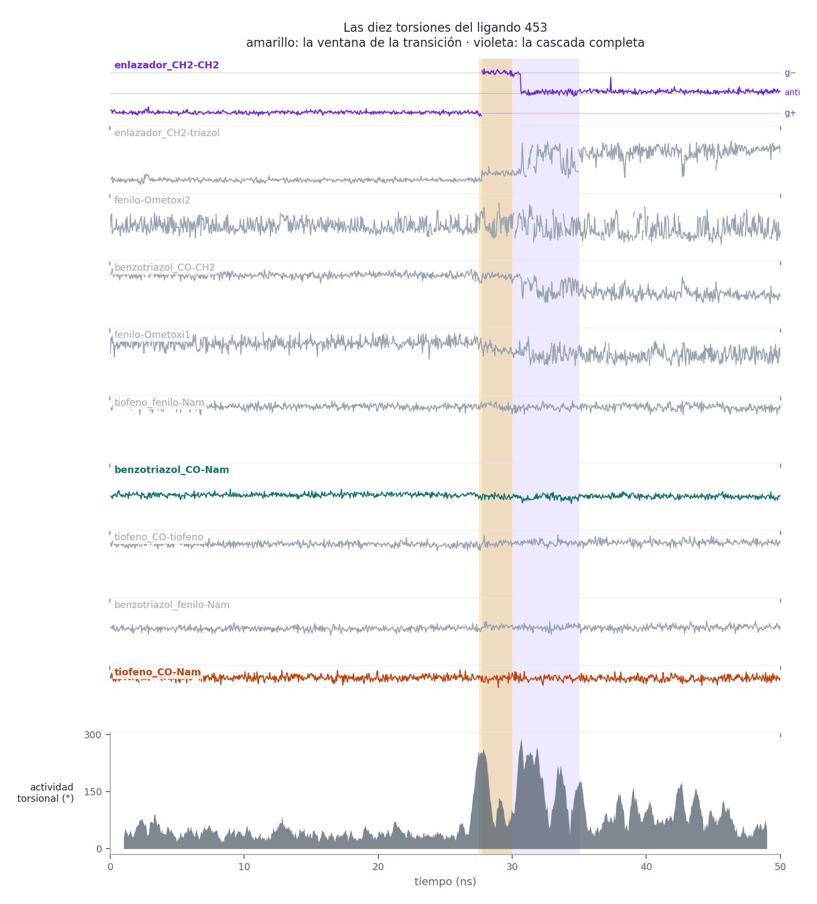
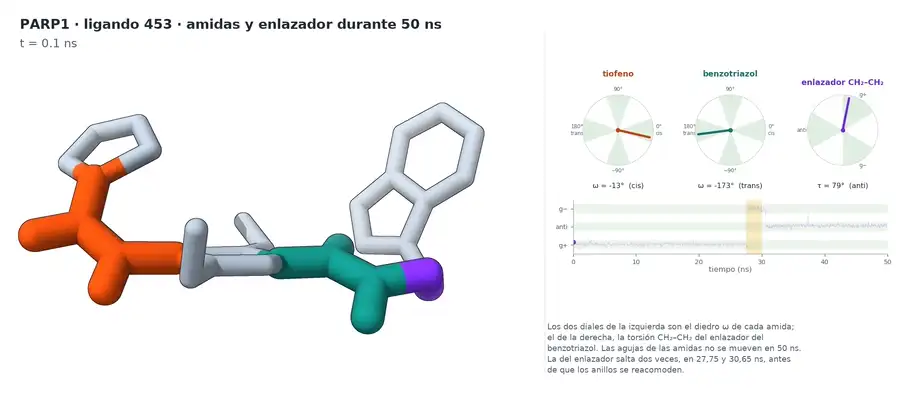

# Resultados de la dinámica molecular

> Una sola réplica de 50 ns del ligando 453. Trabajo exploratorio
> posterior al TFM, hecho para aprender. Antes de leer estas cifras,
> pasa por [limitations.md](../../docs/limitations.md).

Los parámetros completos de la simulación están en
[02_molecular_dynamics.md](../../docs/02_molecular_dynamics.md).

## La gráfica


Arriba, el RMSD de los 32 átomos pesados del ligando respecto al
fotograma 0, con la proteína alineada por el backbone. Abajo, la
distancia de cada anillo al centro del sándwich Tyr896/Tyr907.

| Ventana | RMSD del ligando | Puentes de H dominantes |
|---|---|---|
| 0 – 27,5 ns | media **1,21 Å** (máx. 2,26) | Ala880 34 % |
| 27,5 – 30 ns | transición | Asp766 20 %, Tyr896 12 % |
| 30 – 50 ns | media **5,60 Å** (4,24 – 6,53) | Tyr896 50,9 %, Asp766 50,1 % |

Qué pasa: la pose del docking se mantiene unos 28 ns y después el
ligando pasa a otro modo de unión. El benzotriazol, que al principio
está encajado entre las dos tirosinas, deja el sitio al dimetoxifenilo.
El puente de hidrógeno con Ala880 se pierde y aparecen los de Tyr896 y
Asp766.

**Qué lo mueve:** un cambio de rotámero del enlazador propanamida del
benzotriazol. La torsión CH₂−CH₂ pasa de *gauche*+ a *gauche*− en
**27,75 ns** y a *anti* en **30,65 ns**, y el reacomodo de los anillos
va detrás, no delante. De los **diez enlaces rotables** del ligando es
el único que salta dentro de la ventana, y **sus dos saltos son los dos
cambios torsionales mayores de toda la simulación** (Δ117° y Δ115°).



**Qué le hace el cambio a la molécula.** Partiendo el ligando en núcleo
(21 átomos: dimetoxifenilo, metoxilos, las dos amidas y el tiofeno) y
brazo (11: los dos CH₂ y el benzotriazol), con
`tables/fragmentos.csv`:

| | 0–27,5 ns | 35–50 ns |
|---|---|---|
| núcleo, deformación interna | 0,39 Å | **0,42 Å** |
| brazo, respecto al núcleo | 1,92 Å | **7,06 Å** |
| núcleo, en el bolsillo | 0,68 Å | **3,31 Å** |
| brazo, en el bolsillo | 1,82 Å | **8,51 Å** |

El núcleo **no cambia de forma** en 50 ns: todo el cambio
conformacional es el brazo. Pero el brazo no cuelga suelto — se va
8,5 Å y arrastra al núcleo 3,3 Å, y por eso los anillos se
intercambian. La red de puentes de hidrógeno se sustituye entera, sin
conservar ninguno.

**La transición es una cascada, no un instante.** El disparo es el
CH₂−CH₂ en 27,75 ns, pero el brazo del benzotriazol sigue
reacomodándose hasta **~35 ns**: CH₂−triazol salta en 31,25 · 33,60 ·
34,95 y C(=O)−CH₂ en 31,85. Por eso la franja violeta de la figura es
más ancha que la ventana amarilla, y por eso la tabla de arriba, que
trata 30–50 ns como un solo estado, es una simplificación: los primeros
5 ns de esos 20 son todavía transitorio. Las dos amidas no se
mueven en toda la simulación (`tables/amidas.csv`). El detalle, y la
reserva importante sobre el confórmero de partida, en
[limitations.md](../../docs/limitations.md).

En ningún momento hay puente de hidrógeno con **Gly863** (el aceptor más
cercano se queda a 6–7 Å) ni con **Ser904**, que son los contactos
canónicos de los inhibidores de PARP1.

**Qué indica esto:** que una buena puntuación de docking no garantiza
que la pose sea estable. **No** indica que el ligando sea inactivo; con
una sola réplica de 50 ns no se puede afirmar tal cosa.

## Vídeo

[](videos/ligando453_animacion_60fps.mp4)

Animación completa de los 50 ns, con cámara lenta ×6 en la transición y
gráfico de RMSD sincronizado. Lo de arriba es una vista previa reducida
(720 px, 24 fps); el vídeo original está en
[`videos/ligando453_animacion_60fps.mp4`](videos/ligando453_animacion_60fps.mp4)
(1600×1000, 60 fps, 31 MB).

### Las torsiones

[](videos/ligando453_amidas.mp4)

[`videos/ligando453_amidas.mp4`](videos/ligando453_amidas.mp4)
(2000×900, 30 fps, 33 s) — el ligando solo, girando una vuelta
completa, con las dos amidas resaltadas y tres diales en vivo: el
diedro ω de cada amida y la torsión CH₂−CH₂ del enlazador. Las dos
agujas de las amidas no se mueven en 50 ns; la del enlazador salta dos
veces.

El resto va como adjunto de un *release*, que todavía no existe:

| Fichero | Tamaño | Qué es |
|---|---|---|
| `ligando453_animacion_30fps.mp4` | 24 MB | La misma animación, a 30 fps |
| `ligando453_cambio_modo_union.mp4` | 8 MB | Solo la transición |
| `traj_ligera.xtc` | 21 MB | Trayectoria sin agua, 1001 fotogramas. Hace falta para regenerar tablas y figuras |

Para regenerar las tablas y la figura hay que descargar
`traj_ligera.xtc` del release y colocarla en `data/md/`.

## Contenido de esta carpeta

```
figures/
  transicion.png                    RMSD + posición de los anillos
  torsiones.png                     las diez torsiones y la actividad torsional
  dos_poses.png                     comparación de las dos poses
  ligando453_estilo_revista.png     render del sitio de unión
  equilibration/                    T, P, densidad y RMSD del backbone
tables/
  por_fotograma.csv                 tiempo, RMSD, nº y residuos de puentes de H
  ocupacion.csv                     % de puente de H y de contacto por residuo
  anillos.csv                       distancia de cada anillo al sándwich
  amidas.csv                        diedro ω y desviación del plano de las dos amidas
  torsiones.csv                     los diez enlaces rotables del ligando
  fragmentos.csv                    movimiento del núcleo y del brazo, por separado
  plan_render_60fps.csv             correspondencia fotograma de vídeo ↔ coordset
videos/
  ligando453_animacion_60fps.mp4    animación final (60 fps)
  ligando453_animacion_preview.webp vista previa para el README (720 px, 24 fps)
  ligando453_amidas.mp4             amidas y enlazador, con diales (30 fps)
  ligando453_amidas_preview.webp    vista previa para el README (900 px, 12 fps)
  equilibration/                    .xvg de NVT y NPT
logs/
  md_50ns.log                       log de GROMACS de la producción
  energy_check.xvg                  energías de la producción
```

## Dos avisos sobre las tablas

1. **`ocupacion.csv` promedia los 50 ns enteros**, incluida la
   transición. Por eso Tyr896 y Asp766 aparecen al 21 %, no al 50 %: ese
   50 % es dentro de la ventana 30–50 ns. Si lo que interesa es una de
   las dos poses, hay que filtrar `por_fotograma.csv` por ventana.
2. **Los metoxilos de `torsiones.csv` se mueven mucho y no significan
   nada.** `fenilo-Ometoxi1` y `fenilo-Ometoxi2` tienen amplitudes de
   ~45°, de las mayores de la tabla, y registran saltos. Pero un
   aril-metoxilo tiene sus dos mínimos en coplanar, a 0° y 180°, que son
   casi degenerados: esos saltos son el grupo volcando entre dos
   orientaciones equivalentes, no un cambio conformacional. Los valores
   lo delatan, siempre merodeando ±180.
3. **`anillos.csv` tiene dos columnas con la misma cabecera**
   (`6-CCCCCC`): el dimetoxifenilo y el benceno del benzotriazol son los
   dos anillos de seis carbonos. `grafica.py` las distingue por el orden
   en que ChimeraX enumera los anillos, no por un criterio químico. La
   asignación encaja con los datos, pero está sin verificar por índices
   de átomo.

## Cómo regenerar esto

Con `traj_ligera.xtc` en `data/md/`, desde la raíz del repositorio:

```bash
# en ChimeraX, arrancado desde la raíz del repositorio
open data/md/frame0.pdb
open data/md/traj_ligera.xtc structureModel #1
runscript scripts/md_analysis/analiza.py
runscript scripts/md_analysis/anillos.py
runscript scripts/md_analysis/amidas.py
runscript scripts/md_analysis/torsiones.py
runscript scripts/md_analysis/fragmentos.py

# en la terminal
python scripts/md_analysis/grafica.py
python scripts/md_analysis/grafica_torsiones.py
```

El vídeo (~20 min de renderizado, deja ~1 GB en `run/render/`):

```bash
# en ChimeraX
open scripts/md_analysis/estilo_revista.cxc
runscript scripts/md_analysis/render_animacion.py

# en la terminal
python scripts/md_analysis/render_inset.py
python scripts/md_analysis/componer.py
ffmpeg -framerate 60 -i run/render/final/%04d.png \
       -c:v libx264 -crf 16 -pix_fmt yuv420p \
       ligando453_animacion_60fps.mp4
```

El vídeo de las torsiones (~40 min de renderizado). Necesita
`amidas.csv` y `torsiones.csv` ya generados, y **no** hay que pasar
antes `suaviza.py`: la media móvil amortiguaría justo las oscilaciones
del diedro que el vídeo enseña.

```bash
# en ChimeraX, desde la raíz del repositorio
open data/md/frame0.pdb
open data/md/traj_ligera.xtc structureModel #1
runscript scripts/md_analysis/render_amidas.py

# en la terminal
python scripts/md_analysis/inset_amidas.py
python scripts/md_analysis/componer_amidas.py
ffmpeg -framerate 30 -i run/render/amidas/final/%04d.png \
       -c:v libx264 -crf 18 -pix_fmt yuv420p \
       results/md/videos/ligando453_amidas.mp4
```
