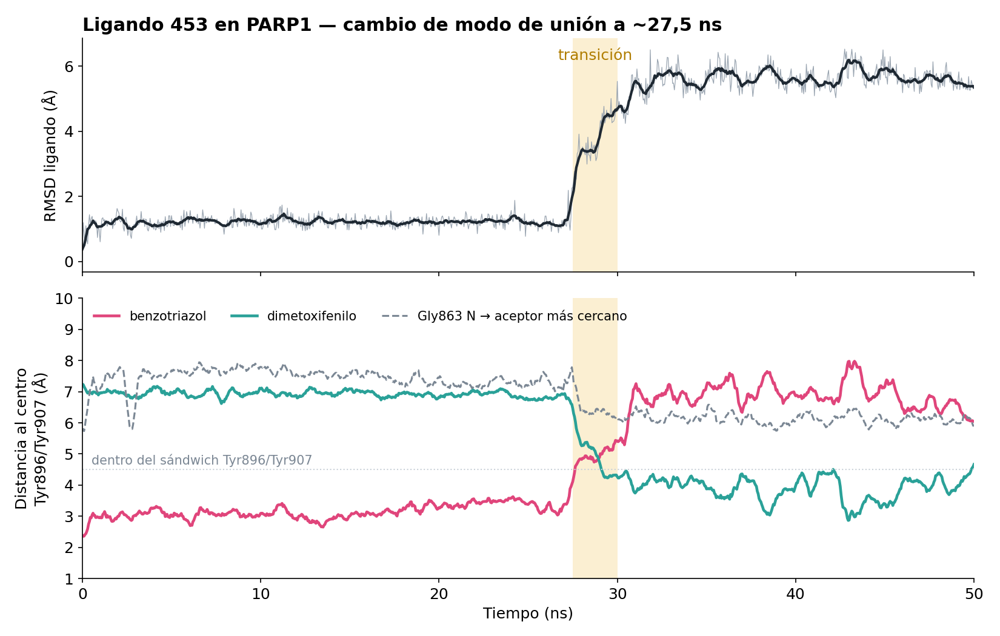
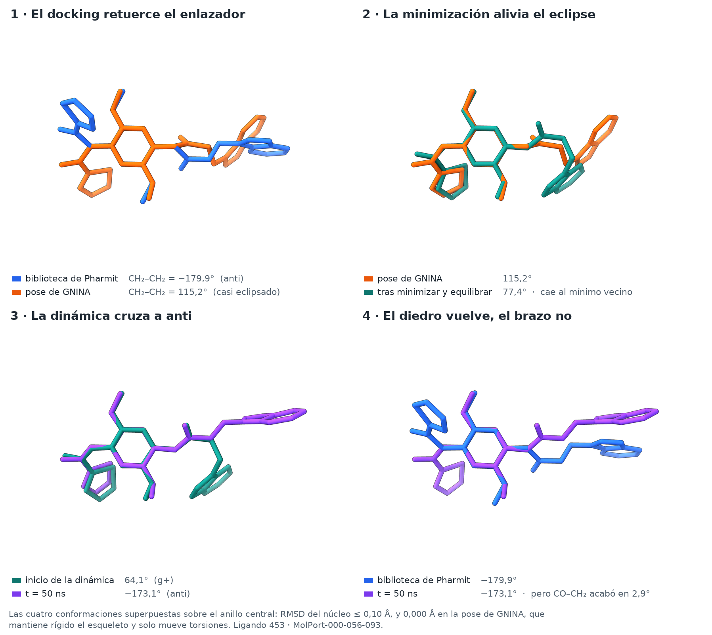
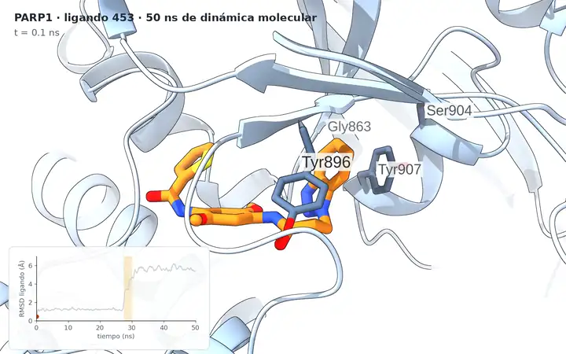
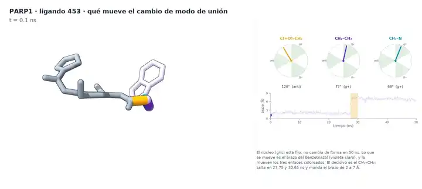

# Resultados de la dinámica molecular

> Una sola réplica de 50 ns del ligando 453. Trabajo exploratorio
> posterior al TFM, hecho para aprender. Antes de leer estas cifras,
> pasa por [limitations.md](../../docs/limitations.md).

Los parámetros completos de la simulación están en
[02_molecular_dynamics.md](../../docs/02_molecular_dynamics.md).

## La gráfica



Arriba, el RMSD de los 32 átomos pesados del ligando respecto al
fotograma 0, con la proteína alineada por el backbone. Abajo, la
distancia de cada anillo al centro del sándwich Tyr896/Tyr907.

| Ventana | RMSD del ligando | Puentes de H dominantes |
|---|---|---|
| 0 – 27,5 ns | media **1,21 Å** (máx. 2,26) | Ala880 34 % |
| 27,5 – 30 ns | transición | Asp766 20 %, Tyr896 12 % |
| 30 – 50 ns | media **5,60 Å** (4,24 – 6,53) | Tyr896 50,9 %, Asp766 50,1 % |

Qué pasa: la pose del docking se mantiene unos 28 ns y después el
ligando pasa a otro modo de unión. El benzotriazol, que al principio
está encajado entre las dos tirosinas, deja el sitio al dimetoxifenilo.
El puente de hidrógeno con Ala880 se pierde y aparecen los de Tyr896 y
Asp766.

**Qué lo mueve:** un cambio de rotámero del enlazador propanamida del
benzotriazol. La torsión CH₂−CH₂ pasa de *gauche*+ a *gauche*− en
**27,75 ns** y a *anti* en **30,65 ns**, y el reacomodo de los anillos
va detrás, no delante. De los **diez enlaces rotables** del ligando es
el único que salta dentro de la ventana, y **sus dos saltos son los dos
cambios torsionales mayores de toda la simulación** (Δ117° y Δ115°).


**Qué le hace el cambio a la molécula.** Partiendo el ligando en núcleo
(21 átomos: dimetoxifenilo, metoxilos, las dos amidas y el tiofeno) y
brazo (11: los dos CH₂ y el benzotriazol), con
`tables/fragmentos.csv`:

| | 0–27,5 ns | 35–50 ns |
|---|---|---|
| núcleo, deformación interna | 0,39 Å | **0,42 Å** |
| brazo, respecto al núcleo | 1,92 Å | **7,06 Å** |
| núcleo, en el bolsillo | 0,68 Å | **3,31 Å** |
| brazo, en el bolsillo | 1,82 Å | **8,51 Å** |

El núcleo **no cambia de forma** en 50 ns: todo el cambio
conformacional es el brazo. Pero el brazo no cuelga suelto — se va
8,5 Å y arrastra al núcleo 3,3 Å, y por eso los anillos se
intercambian. La red de puentes de hidrógeno se sustituye entera, sin
conservar ninguno.

**La transición es una cascada, no un instante.** El disparo es el
CH₂−CH₂ en 27,75 ns, pero el brazo del benzotriazol sigue
reacomodándose hasta **~35 ns**: CH₂−triazol salta en 31,25 · 33,60 ·
34,95 y C(=O)−CH₂ en 31,85. Por eso la franja violeta de la figura es
más ancha que la ventana amarilla, y por eso la tabla de arriba, que
trata 30–50 ns como un solo estado, es una simplificación: los primeros
5 ns de esos 20 son todavía transitorio. Las dos amidas no se
mueven en toda la simulación (`tables/amidas.csv`). El detalle, y la
reserva importante sobre el confórmero de partida, en
[limitations.md](../../docs/limitations.md).

En ningún momento hay puente de hidrógeno con **Gly863** (el aceptor más
cercano se queda a 6–7 Å) ni con **Ser904**, que son los contactos
canónicos de los inhibidores de PARP1. **Pero la pose dockeada sí lo
tenía**, a 3,28 Å, y lo había perdido ya en el fotograma 0 (5,72 Å):
durante la minimización y el equilibrado, no a los 28 ns. Gly863 es el
puente más conservado del farmacóforo de consenso, 67,74 % de los
complejos de referencia.

## De dónde sale la tensión de la pose



`tables/tension_torsional.csv` mide la energía de torsión propia de los
diez enlaces rotables en las cuatro etapas, con el cero de cada enlace en
su propio mínimo:

```
TOTAL de los diez enlaces (kcal/mol)
  confórmero de la biblioteca   17,50
  pose de GNINA                 34,84     <- el docking añade 17,34
  fotograma 0                   22,79     <- la minimización suelta 12,05
  media 0-27,5 ns               21,58
  media 35-50 ns                24,25     <- los 50 ns no sueltan nada
```

El 92 % de esos 17,34 está en tres enlaces, y **el mayor no es el
enlazador**: es `benzotriazol_fenilo-Nam`, el arilo−N de la amida del
benzotriazol, que GNINA deja a **10,82 de una barrera de 10,87** —casi en
la cima— y que suelta los 8,27 enteros en la minimización girando 123°.
Ese es el enlace que mueve el brazo 4 Å y rompe el puente con Gly863.

Y corrige una lectura anterior: **la dinámica no destuerce nada.** La
tensión torsional no baja en los 50 ns, sube 2,7. El cambio de modo de
unión de los 28 ns no lo mueve la relajación interna, sino lo que se gana
en interacciones: los puentes de hidrógeno pasan de 0,35 a 1,06 por
fotograma. **El enlazador es la puerta, no el motor.**

`alcance.py` cierra el argumento barriendo los tres diedros del enlazador
(46 656 combinaciones) con todo lo demás clavado: en la geometría de la
pose, el puente con Gly863 solo se hace pagando ≥ **4,23 kcal/mol**, y
con los tres diedros relajados el triazol se queda a **9,7 Å**. En el
fotograma 0 ya no se alcanza a ningún valor de torsión.

**Qué indica esto:** que una buena puntuación de docking no garantiza
que la pose sea estable, y que el paso de selección evaluó una
**geometría** en vez de un **estado**. **No** indica que el ligando sea
inactivo: no se sale del bolsillo (Tyr896 99,9 % de contacto) y acaba
mejor unido que empezó. Con una sola réplica de 50 ns no se puede
afirmar tal cosa.

El desglose enlace por enlace, los límites de estas cifras y las dos
lecturas que quedan abiertas, en
[limitations.md](../../docs/limitations.md).

## Vídeo

[](https://github.com/AndoniM12/PARP1-Virtual-Screening/releases/download/v2.1/ligando453_animacion_60fps.mp4)

Animación completa de los 50 ns, con cámara lenta ×6 en la transición y
gráfico de RMSD sincronizado. Lo de arriba es una vista previa reducida
(720 px, 24 fps); el vídeo original está en
[`ligando453_animacion_60fps.mp4`](https://github.com/AndoniM12/PARP1-Virtual-Screening/releases/download/v2.1/ligando453_animacion_60fps.mp4)
(1600×1000, 60 fps, 31 MB).

### Las torsiones del enlazador

[](https://github.com/AndoniM12/PARP1-Virtual-Screening/releases/download/v2.1/ligando453_torsiones.mp4)

`ligando453_torsiones.mp4` (2000×900, 60 fps, 33 s) — el ligando solo,
superpuesto sobre su **núcleo**, de modo que el núcleo queda fijo y se
ve salir el brazo del benzotriazol. Tres diales, uno por enlace del
enlazador, y debajo cuánto se ha desplazado el brazo. La aguja del
CH₂−CH₂ salta en 27,75 y 30,65 ns y manda el brazo de 2 a 7 Å.

### Las dos amidas

[](https://github.com/AndoniM12/PARP1-Virtual-Screening/releases/download/v2.1/ligando453_amidas.mp4)

[`ligando453_amidas.mp4`](https://github.com/AndoniM12/PARP1-Virtual-Screening/releases/download/v2.1/ligando453_amidas.mp4)
(2000×900, 30 fps, 33 s) — el ligando solo, girando una vuelta
completa, con las dos amidas resaltadas y tres diales en vivo: el
diedro ω de cada amida y la torsión CH₂−CH₂ del enlazador. Las dos
agujas de las amidas no se mueven en 50 ns; la del enlazador salta dos
veces.

**Los vídeos no están en el repositorio**: van como adjuntos del
[release v2.1](https://github.com/AndoniM12/PARP1-Virtual-Screening/releases/tag/v2.1). Un binario confirmado en git se queda en el
historial para siempre y no se comprime por diferencias, así que cada
versión de un vídeo pesaría otra vez entera. Como adjunto se puede
reemplazar sin dejar rastro. En el repositorio quedan solo las
miniaturas reducidas.

| Fichero del release | Tamaño | Qué es |
|---|---|---|
| `ligando453_animacion_60fps.mp4` | 31 MB | La animación en el sitio de unión, con cámara lenta |
| `ligando453_amidas.mp4` | 12 MB | Las dos amidas y el enlazador, con diales |
| `ligando453_torsiones.mp4` | 10 MB | Qué mueve el cambio de modo de unión, 60 fps |
| `traj_ligera.xtc` | 21 MB | Trayectoria sin agua, 1001 fotogramas. Hace falta para regenerar tablas y figuras |

Para regenerar las tablas y la figura hay que descargar
`traj_ligera.xtc` del release y colocarla en `data/md/`.

## Contenido de esta carpeta

```
figures/
  transicion.png                    RMSD + posición de los anillos
  torsiones.png                     las diez torsiones y la actividad torsional
  conformeros.png                   las cuatro conformaciones por las que pasa el ligando
  dos_poses.png                     comparación de las dos poses
  cis_amida.png                     la amida del tiofeno entró en cis
  entrada_vs_50ns.png               el confórmero de la biblioteca contra el de 50 ns
  ligando453_estilo_revista.png     render del sitio de unión
  equilibration/                    T, P, densidad y RMSD del backbone
tables/
  por_fotograma.csv                 tiempo, RMSD, nº y residuos de puentes de H
  ocupacion.csv                     % de puente de H y de contacto por residuo
  anillos.csv                       distancia de cada anillo al sándwich
  amidas.csv                        diedro ω y desviación del plano de las dos amidas
  torsiones.csv                     los diez enlaces rotables del ligando
  fragmentos.csv                    movimiento del núcleo y del brazo, por separado
  tension_torsional.csv             tensión de cada enlace en las cuatro etapas
  plan_render_60fps.csv             correspondencia fotograma de vídeo ↔ coordset
videos/
  ligando453_animacion_preview.webp  vista previa (720 px, 24 fps)
  ligando453_amidas_preview.webp     vista previa (900 px, 12 fps)
  ligando453_torsiones_preview.webp  vista previa (720 px, 7 fps)
  (los mp4 completos van en el release, no en el repositorio)
  equilibration/                    .xvg de NVT y NPT
logs/
  md_50ns.log                       log de GROMACS de la producción
  energy_check.xvg                  energías de la producción
```

## Dos avisos sobre las tablas

1. **`ocupacion.csv` promedia los 50 ns enteros**, incluida la
   transición. Por eso Tyr896 y Asp766 aparecen al 21 %, no al 50 %: ese
   50 % es dentro de la ventana 30–50 ns. Si lo que interesa es una de
   las dos poses, hay que filtrar `por_fotograma.csv` por ventana.
2. **Los metoxilos de `torsiones.csv` se mueven mucho y no significan
   nada.** `fenilo-Ometoxi1` y `fenilo-Ometoxi2` tienen amplitudes de
   ~45°, de las mayores de la tabla, y registran saltos. Pero un
   aril-metoxilo tiene sus dos mínimos en coplanar, a 0° y 180°, que son
   casi degenerados: esos saltos son el grupo volcando entre dos
   orientaciones equivalentes, no un cambio conformacional. Los valores
   lo delatan, siempre merodeando ±180.
3. **`anillos.csv` tiene dos columnas con la misma cabecera**
   (`6-CCCCCC`): el dimetoxifenilo y el benceno del benzotriazol son los
   dos anillos de seis carbonos. La figura las distingue por el orden
   en que ChimeraX enumera los anillos, no por un criterio químico. La
   asignación encaja con los datos, pero está sin verificar por índices
   de átomo.

## Cómo regenerar esto

Con `traj_ligera.xtc` en `data/md/`, desde la raíz del repositorio:

```bash
# en ChimeraX, arrancado desde la raíz del repositorio
open data/md/frame0.pdb
open data/md/traj_ligera.xtc structureModel #1
runscript scripts/md_analysis/analiza.py
runscript scripts/md_analysis/anillos.py
runscript scripts/md_analysis/amidas.py
runscript scripts/md_analysis/torsiones.py
runscript scripts/md_analysis/fragmentos.py
runscript scripts/md_analysis/conformeros.py

# en la terminal
python scripts/md_analysis/escena_cuatro.py   # renombra las cuatro etapas
python scripts/md_analysis/tension.py         # tension_torsional.csv
```

`escena_cuatro.py` tiene que ir antes de `tension.py`: reescribe las
cuatro conformaciones de `conformeros.py` con los átomos **nombrados
igual en las cuatro**, que es lo que permite medir el mismo enlace en
todas. Cada etapa viene de un formato distinto y conserva el orden de
atomos de su fichero de origen.

El barrido que contesta si el ligando puede alcanzar Gly863 sin tensión
va aparte, porque tarda unos minutos y no escribe tabla:

```bash
python scripts/md_analysis/alcance.py 10      # paso de la rejilla, en grados
```

Y la escena para girar los enlaces a mano y comparar las cuatro
conformaciones, con los tres diedros del enlazador y las distancias en
vivo:

```bash
chimerax run/render/alcance/cuatro/girar_cuatro.cxc
```

El botón derecho queda en modo `bond rotation`. Ojo: **los arrastres con
el ratón no entran en la pila de `undo`**, así que la escena define
`reset1`…`reset4` y `reset` para devolver cada modelo a sus valores de
origen.

## Los vídeos y las figuras

Los mp4 completos están en el [release
v2.1](https://github.com/AndoniM12/PARP1-Virtual-Screening/releases/tag/v2.1);
en `videos/` solo van las vistas previas.

Los scripts que montan esos vídeos, y los que dibujan las figuras de
`figures/`, **no están en este repositorio**: aquí se guarda lo que
produce los datos, no lo que los representa. Las tablas de `tables/` son
la fuente de todas las figuras, así que cualquiera puede rehacerlas a su
manera.
