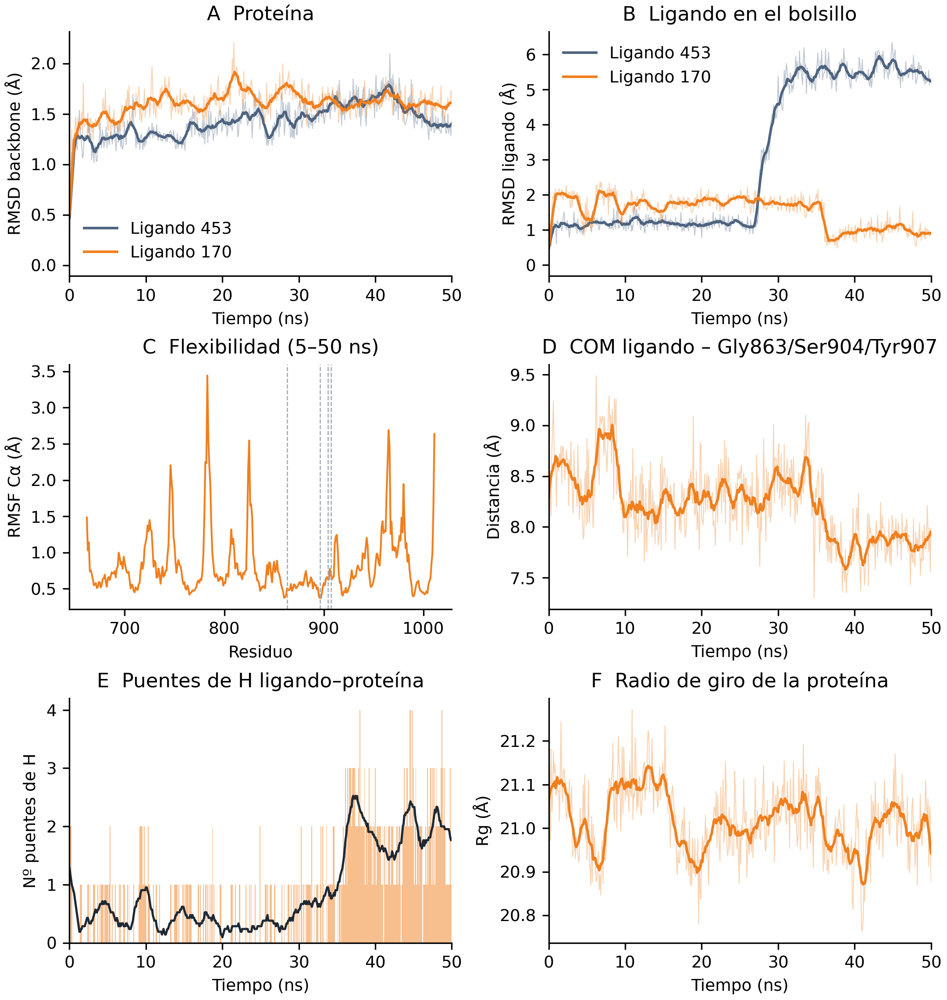
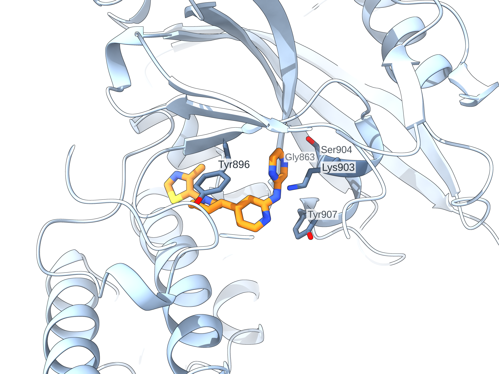
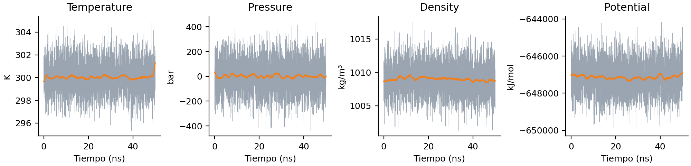

# Resultados de la dinámica molecular — ligando 170

> Una sola réplica de 50 ns del ligando 170 (`Molport-053-317-044`),
> con el mismo protocolo que la del [ligando 453](../ligand_453/README.md)
> para que las dos se puedan comparar. Trabajo exploratorio posterior al
> TFM, hecho para aprender. Antes de leer estas cifras, pasa por
> [limitations.md](../../../docs/limitations.md).

Los parámetros de la simulación están en
[02_molecular_dynamics.md](../../../docs/02_molecular_dynamics.md). La
procedencia de cada fichero de entrada, en
[../../../data/md/ligand_170/PROCEDENCIA.md](../../../data/md/ligand_170/PROCEDENCIA.md).

```
Molport-053-317-044
C19H22N6S, 366,5 Da, 26 átomos pesados, 5 enlaces rotables
SMILES: Cc1ncsc1CN1CCC[C@@H](c2ccnc(Nc3cnccn3)c2)C1
```

## La gráfica



Seis paneles: RMSD del backbone y del ligando (con el 453 superpuesto en
los dos), RMSF por residuo, distancia del centro de masas del ligando al
del bolsillo, número de puentes de hidrógeno y radio de giro.

## Qué pasa

| Magnitud (10–50 ns) | Ligando 170 | Ligando 453 |
|---|---|---|
| RMSD del backbone | 1,64 ± 0,12 Å | 1,46 ± 0,16 Å |
| RMSD del ligando en el bolsillo, átomos pesados | **1,48 ± 0,44 Å** (máx. 2,37) | 3,49 ± 2,10 Å (máx. 6,34) |
| RMSD interno del ligando | 0,69 ± 0,22 Å | — |
| Distancia COM ligando–bolsillo | 8,13 ± 0,34 Å | — |
| Radio de giro de la proteína | 21,01 ± 0,08 Å | — |

**El 170 se queda donde lo puso el docking, y el 453 no.** Aquel cambiaba
de modo de unión a los 27,5 ns y el RMSD del ligando subía a 5,6 Å. Este
se mantiene por debajo de 2,4 Å los 50 ns enteros, y hacia los **36 ns**
se reacomoda *hacia* la pose de partida: el RMSD baja de ~1,8 a ~0,97 Å y
ahí se queda.

| Ventana | RMSD del ligando | Puentes de H dominantes |
|---|---|---|
| 0 – 36 ns | media **1,79 Å** (máx. 2,41) | Tyr907 5 %, Lys903 4 % |
| 36 – 50 ns | media **0,97 Å** (máx. 1,81) | **Ser904 48 %, Lys903 20 %, Gly863 18 %** |

En la segunda ventana aparecen los puentes de hidrógeno que se le piden a
un inhibidor de PARP1 en el bolsillo de la nicotinamida: **Ser904** y
**Gly863**. Ninguno de los dos estaba en los primeros 36 ns, y el 453 no
llegó a formarlos en ningún momento (perdió el de Gly863 ya en el
fotograma 0; ver [limitations.md](../../../docs/limitations.md)).

El contacto, en cambio, es estable desde el principio: Tyr896, Arg878 y
Tyr907 están a menos de 4 Å en el 100 % de los fotogramas
(`tables/ocupacion.csv`).

Los anillos dicen lo mismo (`tables/anillos.csv`, distancia al centro del
sándwich Tyr896/Tyr907):

| Anillo | 0 – 36 ns | 36 – 50 ns |
|---|---|---|
| tiazol | 9,32 ± 0,34 Å | 9,20 ± 0,70 Å |
| piperidina | 5,18 ± 0,30 Å | 4,74 ± 0,71 Å |
| **piridina** | 2,16 ± 0,35 Å | **1,38 ± 0,45 Å** |
| pirazina | 2,87 ± 0,36 Å | 4,44 ± 0,36 Å |
| **aceptor más cercano al N de Gly863** | 6,04 Å | **3,31 Å** |

El reacomodo de los 36 ns mete la piridina más adentro del sándwich de
tirosinas y saca la pirazina. Y la última fila es el dato que cierra la
comparación: el aceptor más cercano al N de Gly863 pasa de 6,04 a
**3,31 Å**, por debajo de 3,5 Å en el 83 % de los últimos 14 ns. El
docking lo había puesto a 3,41 Å; la dinámica lo recupera. El 453 entró
en su simulación con ese mismo contacto ya roto (5,72 Å en el fotograma 0,
frente a los 3,28 Å del docking) y no lo recuperó nunca.



## Control de la simulación



Temperatura 300,0 ± 1,3 K, densidad 1009 ± 2 kg/m³, presión media 0,8 bar
y energía potencial sin deriva. El radio de giro no se mueve y el RMSF de
los residuos del bolsillo es de 0,4–0,7 Å; los picos de flexibilidad
(hasta 3,4 Å) son bucles expuestos: 781–784, 825, 965–966 y 1011.

## Avisos

1. **Una réplica no distingue una pose estable de una trayectoria con
   suerte.** Que el 170 aguante 50 ns y el 453 no es una diferencia de
   una tirada contra una tirada, no una medida. Para afirmar que el 170
   es el mejor candidato hacen falta réplicas de los dos.
2. **La pose de los últimos 14 ns está poco muestreada.** Los puentes de
   Ser904 y Gly863 se forman a los 36 ns y solo se ven durante 14 ns. No
   se puede decir si es el estado final o un episodio más.
3. **El número de puentes de hidrógeno depende del criterio.** Las tablas
   de esta carpeta usan el de ChimeraX (`find_hbonds`, el mismo que el
   453): el 27 % de los fotogramas tiene al menos uno. `tables/hbnum.xvg`,
   que lo mide con el criterio de `gmx hbond` (0,35 nm y 30°), da el 57 %.
   Los dos están bien; no son comparables entre sí.
4. **`ocupacion.csv` promedia los 50 ns enteros**, igual que en el 453.
   Ser904 aparece al 14 %, no al 48 %: ese 48 % es dentro de la ventana
   36–50 ns. Para una de las dos poses hay que filtrar
   `por_fotograma.csv`.
5. **`anillos.csv` tiene dos columnas con la misma cabecera**, `6-CCCCCN`,
   porque la piperidina y la piridina tienen la misma fórmula. La primera
   de las dos es la piperidina (lleva 9 hidrógenos sobre el anillo) y la
   segunda la piridina (3). Le pasa lo mismo que a la del 453.
6. **Los primeros 3,47 ns se calcularon en CPU y el resto en GPU**, al
   cambiar a la compilación CUDA de GROMACS a mitad de la tirada (de 10 a
   45,6 ns/día). Es un cambio de hardware, no de física: el `.tpr`, el
   campo de fuerza y el paso de integración son los mismos. Consta en
   `logs/md_50ns.log`, que tiene tres cabeceras `Started mdrun`.

## Contenido de esta carpeta

```
figures/
  analisis_preliminar.png     los seis paneles, con el 453 superpuesto
  termodinamica.png           T, P, densidad y energía potencial de los 50 ns
  escena_170_45ns.png         render del sitio de unión a los 45 ns
  equilibration/              T, P, densidad y RMSD del backbone
tables/
  por_fotograma.csv           tiempo, RMSD, nº y residuos de puentes de H
  ocupacion.csv               % de puente de H y de contacto por residuo
  anillos.csv                 distancia de cada anillo al sándwich de tirosinas
  resumen.csv                 media, sd, máximo y valor final de cada magnitud
  rmsd_backbone.xvg           RMSD del backbone
  rmsd_ligpes_en_bolsillo.xvg RMSD del ligando (26 pesados) con la proteína alineada
  rmsd_ligpes_propio.xvg      deformación interna del ligando
  rmsd_lig_*.xvg              lo mismo, con los 48 átomos (H incluidos)
  rmsf_ca.xvg                 RMSF por residuo, 5–50 ns
  rg.xvg                      radio de giro de la proteína
  dist_bolsillo.xvg           COM del ligando al COM de Gly863/Ser904/Tyr907
  hbnum.xvg                   nº de puentes de H según gmx hbond
  ener_*.xvg                  temperatura, presión, densidad y energía potencial
  equilibration/              .xvg de NVT y NPT
logs/
  md_50ns.log                 log de GROMACS de la producción
```

La comparación con el 453 sale de `../comparacion/`, que tiene el RMSD
del ligando y del backbone de aquella simulación recalculados con el
mismo paso de 100 ps.

## Cómo se regenera

La trayectoria ligera (`traj_fit.xtc`, 10 MB, 501 fotogramas sin agua) va
en el release, no en el repositorio. Se descarga y se coloca en
`data/md/ligand_170/`:

```bash
# tablas de GROMACS, con el entorno md_parp1_cuda
LIGANDO=170 bash scripts/md/ligando/analisis.sh
```

```
# en ChimeraX, arrancado desde la raíz del repositorio
open data/md/ligand_170/frame0.pdb
open data/md/ligand_170/traj_fit.xtc structureModel #1
runscript scripts/md_analysis/analiza.py 170 0.1
runscript scripts/md_analysis/anillos.py 170 0.1
```

El `0.1` es el paso entre fotogramas en ns. El del 453 es 0,05, que es el
valor por defecto de los scripts.
